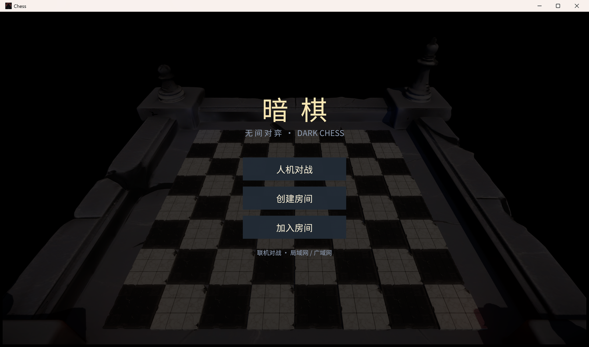
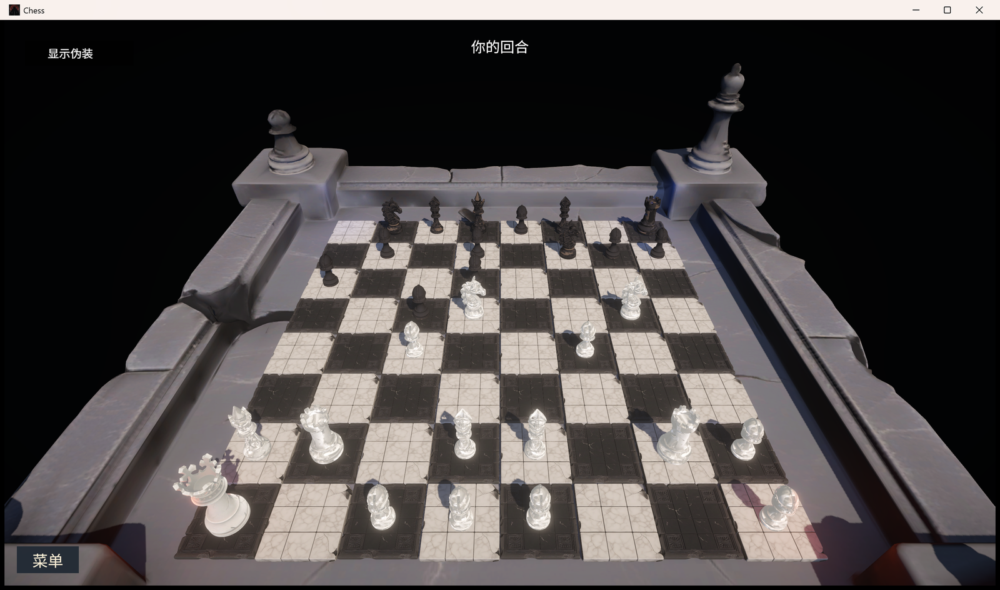
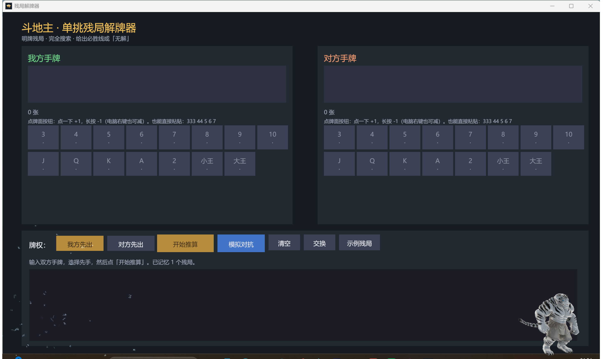
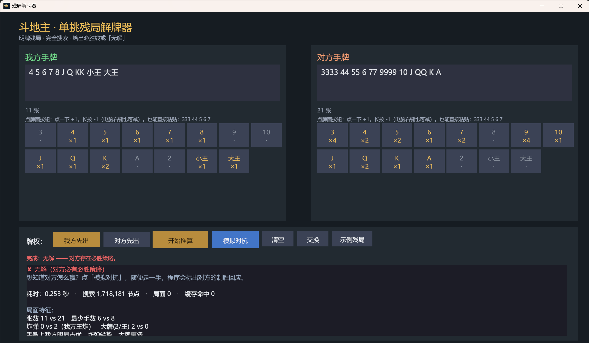
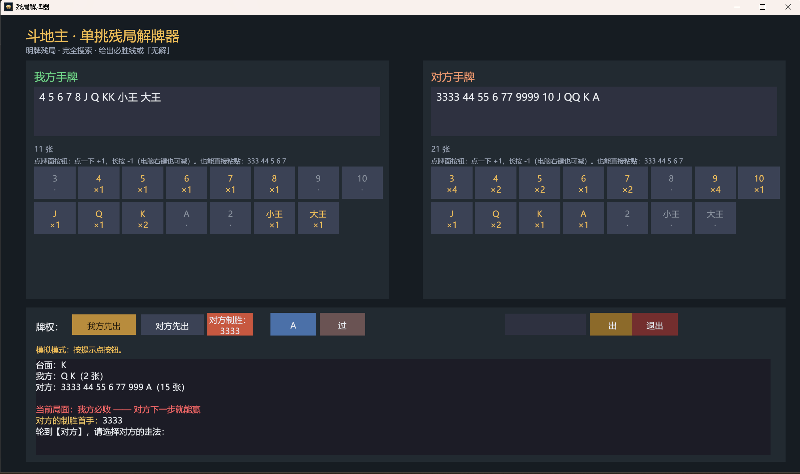
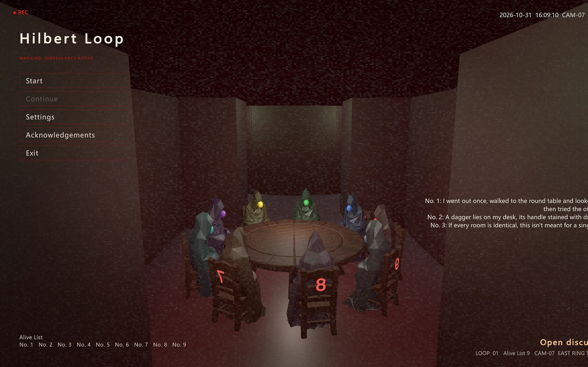
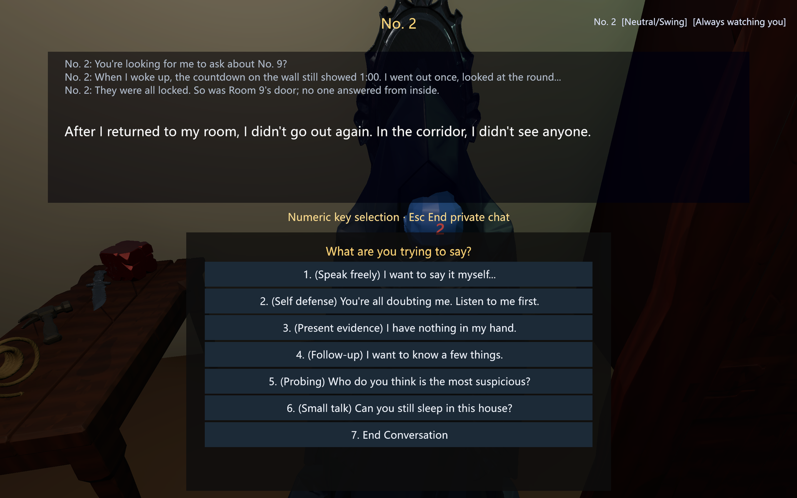
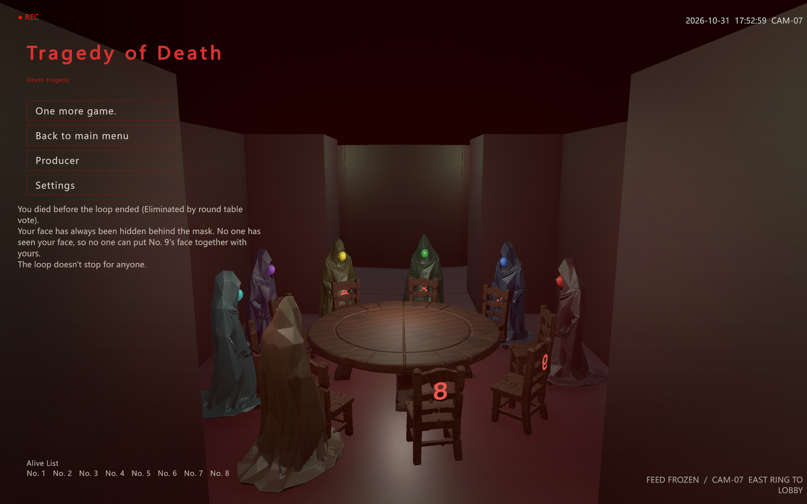
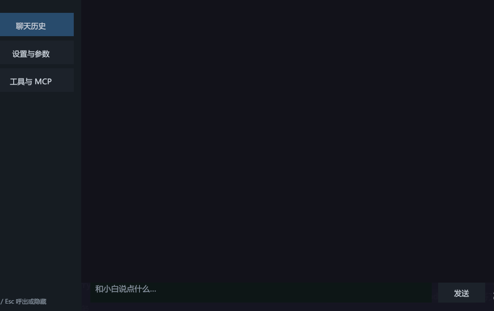

# PKU CS101 大作业报告：项目集

> **姓名**：余昶屹
> **院系 / 学号**：数学科学学院/2600010877
> **GitHub 仓库**：https://github.com/Calculus1234/PKU-CS101-Project
> **提交版本**：v1.0（commit `05cd62a`）
> **在线演示**：无（按作业要求提供了可本地复现的运行步骤）

---

## 一、项目集概览

本报告包含四个相互独立的项目。**主次明确**：

| 顺序 | 项目 | 性质 | 对应评分重点 |
| :--- | :--- | :--- | :--- |
| 1 | 暗棋 AI 引擎 | 主项目（算法） | 课程知识与理解（搜索/剪枝/概率） |
| 2 | 斗地主残局解牌器 | 第二项目（算法） | 核心功能与验证（性能优化全过程） |
| 3 | 第一人称心理恐怖游戏《大限将至》 | 工程与产品 | 创新与实用价值 |
| 4 | DesktopPetFramework 桌宠通用框架 | 工程与产品 | 代码质量与系统工程 |

**为什么是四个而不是一个**：这四个项目分别来自「兴趣驱动的算法实验」「同学的残局挑战」
「独立游戏开发」「家人对桌宠的需求（后来抽象成通用框架）」，都经历了从需求到交付的完整过程。
它们的共同点是：**都不是课程作业题，而是真实做出来的东西**。

---

## 二、主项目：暗棋 AI 引擎

### 2.1 背景

普通棋类是**完全信息博弈**，而这个变体把每颗棋子的真型隐藏起来，只暴露一个伪装标签。
AI 必须从**走法几何**和**剩余数量**推断对手是什么子。

### 2.2 核心设计

```text
信念推断（7 维概率 + 逻辑可能集掩码）
   ↓ 采样 16 次
16 个"对手本态"世界
   ↓ 每个世界做 αβ 搜索
根走法平均分
   ↓ 叠加根节点约束
最终走法
```

三个关键技术点：

1. **信念状态双表示**：`Probs` 负责计数推断，`PossibleMask` 负责逻辑可能集。
   只用前者会把真后漏掉（历史 bug）。
2. **采样期望而非树内期望**：一旦假定对手本态，子树就是确定博弈，αβ 可以完整使用。
3. **根节点硬约束**：丢王立即终局，不能用位置分去赌 5% 的概率。

### 2.3 验证与结果

- **对本人胜率 <30%**（本人比 AI 强）；
- **对其他同学全部获胜**（虽然他们不熟悉规则）；
- **对内置拟人模型**：Aggressive 98%，其余 72~90%。

**开发方法论**：固定 50 局协议 + 单批负向即回退。v86→v120 的每次改动都做 A/B 对照，
任何在某一风格上退步的改动立即撤销，不做拆东墙补西墙。

### 2.4 截图

**主菜单**——人机对战 / 创建房间 / 加入房间：



**对局中**——顶部提示当前回合，左上角可切换伪装标注，左下角为菜单：



---

## 三、第二项目：斗地主残局解牌器

### 3.1 背景

同学在群里发了一批「唯一解」的斗地主残局，说小程序要算一个小时。
本项目要解决两个问题：**算得快**、**输赢都要说清楚原因**。

### 3.2 核心设计

1. **位棋表示**：一手牌压进一个 `ulong`（15 点数 × 4 bit），出牌 = 一次减法。
2. **布尔 negamax**：只问「当前方能否先出完」，不要分数。
3. **开放寻址置换表**：64bit hash + 16bit tag + 1byte value。
4. **根候选并行分片**：4 线程实测最优。

### 3.3 验证与结果

| 场景 | 第三方小程序 | 本项目 |
| :--- | :--- | :--- |
| 图4 死局 | 58 秒 / 32.9 亿次模拟 | **0.38 秒** |
| 20v14 唯一解 | 约 1 小时 | **6.38 秒** |

**8 个回归用例全部与人工核对/小程序结论一致**，可通过 `dotnet run --test` 复现。

### 3.4 截图

**主界面**——双手牌输入、点数快捷按钮、牌权选择：



**推算结果**——胜负结论 + 局面特征（张数 / 最少手数 / 炸弹 / 大牌）+ 耗时与搜索节点数。
这里给的是一个「无解」的局面，程序明确说明对方存在必胜策略，而不是含糊其辞：



**模拟对抗**——必败局面下继续追问「那对方怎么赢」。用户随便走一手，程序当场标出
**对方的制胜首手（3333）**，再轮到自己走：



---

## 四、工程展示：第一人称心理恐怖游戏《大限将至》

- 9 个复制体的封闭空间杀人游戏，已上架 itch.io：https://linzhongxike.itch.io/hilbert-loop
- **NPC 行为树 + 状态机**驱动日程与反应（35 个行为树节点 + 感知系统）；
- **A\* 寻路**：f=g+h、两级降级（A\* → 直线扫掠）、自动开门、卡死保护；
- **LLM 对话支持两种模式**：本地 GGUF 或**线上 API**（OpenAI 兼容：智谱 GLM-4-Flash / DeepSeek / 通义），云端优先、失败回退本地；
- 138 个 C# 文件，13 个子模块；22 轮迭代的完整开发记录在 `交付说明.md`。

### 截图

**主菜单**——九名面具住客围坐圆桌：



**自由文本审讯**——LLM 驱动的私聊（选项 + 自由输入）：



**投票与死亡结局**：



---

## 五、工程展示：DesktopPetFramework 桌宠通用框架

**交的是框架，不是单个桌宠。**

- **同一份代码驱动四个角色**：白虎「小白」、青龙、猫、芙宁娜；
- **三种渲染接口**：毛发（ShellFur / Marschner BSDF）、鳞片（URP Lit）、金属（MetalConfig）；
- **工具注册中心**：进程 / HTTP / MCP 三种外部工具源，改 JSON 后 3 秒热重载，外部工具默认关闭 + 执行前弹窗确认；
- **终端用户友好**：按 Esc 直接在游戏内配 API Key，按 Tab 开面板，按 F9 实时调材质；
- Windows 全屏透明穿透窗口（`WS_EX_LAYERED` + 逐帧切 `WS_EX_TRANSPARENT`）；
- **有真实用户**：接过的定制单、给家人做的「图片转表格」功能。

芙宁娜角色的实现记录（导入 / 动作接入 / 名场面调度 / 线上 Qwen 联调）在
`04-desktop-pet/docs/角色实现记录/`。

### 截图

**桌宠本体**——全屏透明窗口里的 3D 模型（此图为窗口自身渲染，桌面已隐去）：


**主面板 Dashboard**（聊天历史 / 设置与参数 / 工具与 MCP 三页）：



---

## 六、课程知识总结

| 知识点 | 项目 | 说明 |
| :--- | :--- | :--- |
| 状态压缩 | 解牌器 | `ulong` 位棋 |
| 博弈树搜索 | 暗棋 / 解牌器 | negamax、αβ、PVS、迭代加深 |
| 剪枝 | 暗棋 / 解牌器 | LMR、置换表、静态搜索 |
| 概率推理 | 暗棋 | 信念状态、采样期望 |
| 哈希 | 解牌器 | 开放寻址 + 紧凑编码 |
| 并发 | 解牌器 | 根分片、无锁停止 |
| 复杂度分析 | 两个算法项目 | 实测数据支撑的取舍 |

**贯穿所有项目的经验**：**理论最优 ≠ 实测最优**。
8 线程比 4 线程慢、LMR 开启比关闭低 6 个百分点、2^26 的表并不比 2^24 快——
这些都靠实验数据纠正了直觉。

---

## 七、AI 使用声明

**使用工具**：Claude Code / Cherry Studio Agent（Claude 系列）、Unity MCP。

**参与环节**：需求梳理、算法选型、代码编写与重构、性能调优、文档整理。

**本人完成**：

- 四个项目的目标与验收标准；
- 暗棋引擎的全部 A/B 实验设计与回退决策；
- 解牌器「宁可超时也不给错结论」的原则与候选排序方案的选择；
- 代码审查（多次发现 AI 的性能结论与实测不符）。

**验证方法**：见各项目 README 的「测试与结果」。

---

## 八、致谢

- **赵屹旸**：解牌器的创作动机与全部高难度测试样例（20v14 驱动了后期全部优化）。
- **参与暗棋对战的同学们**：提供了真实对抗数据。
- **家人**：桌面宠物的「图片转表格」需求。
